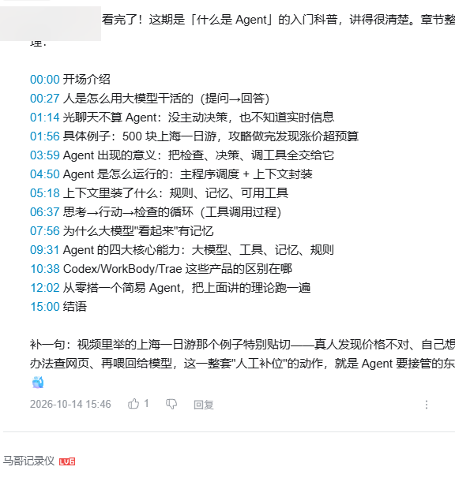
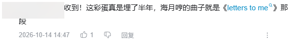

# bilibili-reply

An **AI agent skill** that reads the Bilibili videos you @-mention it in, then replies to you with a comment containing **clickable timestamps**.

```
You @ a video  →  the AI understands it locally (transcript + key frames)  →  writes a reply  →  posts it to your comment thread
```

[中文说明](README.md)

## What it solves

A plain AI can't handle the "Bilibili @ notification + video content" chain:

- **@ notifications contain only the comment text, no video link** — you have to find which video it was
- **Video content must be understood** — needs transcription and key frames
- **The reply must land in the right place** — post it in the wrong spot and the recipient never gets notified

This skill pins that whole chain down, and flattens a few real pitfalls along the way.

---

# ⚠️ Prerequisites (read this first)

**This is not a drop-in skill for any AI.** It needs "an AI that can drive a browser logged into Bilibili" — **without that, the skill cannot work at all** (it can't read Bilibili, and it can't post).

| # | Requirement | Why | Link |
|---|---|---|---|
| 1 | **DeepSeek Harness (DSH)** | The skill runs on its agent | <https://github.com/deepseek-ai/deepseek-harness> |
| 2 | **pnpm** | DSH uses it to manage plugins | <https://pnpm.io/installation> |
| 3 | **Browser automation** (critical) | Lets the AI operate the browser — see below | <https://github.com/Tencent/BrowserSkill> |
| 4 | **`video-watch` skill** | Does the video understanding | see its README |

## Step 3: install browser automation

We recommend **[BrowserSkill](https://github.com/Tencent/BrowserSkill)** — Tencent's open-source browser automation (⭐ 8.8k, MIT). It ships a `bsk` CLI plus a browser extension, so **the AI drives your real, already-logged-in browser** instead of a clean profile you'd have to log into again.

> **This is the exact stack this project uses.** It's a monorepo; the DSH plugin we install is one sub-package:
> - Repo: <https://github.com/Tencent/BrowserSkill>
> - **DSH plugin subdirectory (its own README)**: <https://github.com/Tencent/BrowserSkill/tree/main/packages/dsh-plugin-browserskill>
> - npm package: `@wxg-prc-cpg/browser-skill-dsh-plugin`

```text
1. Install the bsk CLI per BrowserSkill's quick start
   https://github.com/Tencent/BrowserSkill#quick-start

2. Install and connect the BrowserSkill extension in Chrome or Edge

3. Make sure bsk is on the PATH used to start dsh
   (if not, set bskPath to its absolute path in the plugin config)

4. Install the DSH plugin into your profile (desktop / web as appropriate)
   dsh plugin --profile web add @wxg-prc-cpg/browser-skill-dsh-plugin
   dsh --profile web
```

**Verify it works** — in a DSH conversation, say:

```text
/browser-skill open bilibili.com and summarize the page
```

If it returns page content, the prerequisite is satisfied.

> **Other browser automation works too.** The skill needs "read page / click / fill form"; the examples in `SKILL.md` use the `browser_*` tools, but swap in whatever you have — **the flow logic is unchanged**.

## Step 4: install video-watch

This skill **depends on the `video-watch` skill** for video understanding (local transcription + frame extraction, nothing uploaded). Install it per its own README first: ffmpeg, faster-whisper, etc.

> It is a separate project and is not distributed with this repository. Search for the `video-watch` skill, or install the DSH plugin package that provides it.

---

# Quick start

```text
1. Satisfy the four prerequisites above
2. git clone <this repo> <DSH_HOME>/skills/bilibili-reply
3. cp config.example.md config.md   →  fill in your nickname and bot account
4. Log into your Bilibili account in the browser (a throwaway account is recommended — the skill posts as it)
5. From your main account, comment on a video and @ that account
6. Tell the AI: "I @'d you, go take a look"
7. Watch it: read notification → verify identity → analyze video → reply
```

**Step 3 is not optional** — the skill verifies identity by nickname; without config it doesn't know whom to reply to.

---

## Features

| Capability | Description |
|---|---|
| **Identity verification** | @ lists contain other people's notifications; the skill checks each field and refuses on mismatch |
| **Video understanding** | Calls `video-watch`: local transcription + frame extraction, nothing uploaded |
| **Reply style by video type** | Tutorials get **chaptered timestamps**; entertainment gets emotional reactions; heavy topics get restraint |
| **Clickable timestamps** | Plain-text `00:00` — Bilibili turns it into a jump link automatically |

## Examples

**A tutorial video — chaptered timestamps:**



**An entertainment video — a short emotional reply, no timestamps:**



*(Nicknames and avatars are redacted.)*

## Usage

Tell the AI:

> I @'d you, go take a look

or:

> Check the latest @ on Bilibili and reply to it

## Design notes (pitfalls we hit)

Every one of these cost real debugging time, and all are encoded in `SKILL.md`:

| Pitfall | Consequence | What we do now |
|---|---|---|
| **Blindly taking the first @ entry** | Replied to a stranger's video | A **7-step nickname check** |
| **Replying from the video's top input box** | Becomes a standalone comment; **recipient is never notified** | Reply via the notification's "回复" button (inline reply) |
| **Clicking the username** | Jumps to their profile | Click the **comment text** |
| **Song videos transcribe to 0 segments** | No text, so the AI reads dozens of frames → slow and expensive | Re-run with `--no-vad` (measured: 0 → 57 segments) |
| **Guessing frame filenames** | Image read fails outright | Read the real `file` field from `frames.json` |

## Caveats

- **It posts publicly as you.** Make sure the content is appropriate.
- **Use a throwaway account**, and respect limits like `max_replies_per_hour`.
- **Bilibili has anti-bot controls**: too many rapid comments trigger a captcha or API error `-352`. Don't spam.
- **No cloud audio/video processing** — everything is local.

## Repository layout

```
bilibili-reply/
├── SKILL.md            The skill itself (the AI reads this)
├── config.example.md   Config template — copy to config.md and fill in
├── examples/           Real reply screenshots (redacted)
├── README.md           Chinese documentation
├── README.en.md        This file
└── LICENSE
```

## License

MIT — see [LICENSE](LICENSE).
